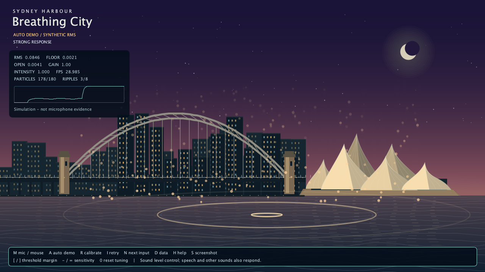

# Breathing City

**52685 Creative Coding A2**

**Student:** Jiangpeng Huang (14559823)

Breathing City is an interactive Processing artwork that maps microphone loudness to a changing Sydney Harbour night scene. A nearby breath or blow can produce a visible response, but the program measures RMS amplitude rather than recognising the sound as human breathing. Speech, music, wind and other sufficiently loud sounds can also activate the scene.

The final runnable sketch is [`BreathingCity/BreathingCity.pde`](BreathingCity/BreathingCity.pde). Keep all five source files in the same `BreathingCity` folder.

## Project goal

The project converts a changing audio level into one shared `energy` value between 0 and 1. That value controls the colour and brightness of the sky and landmarks, window lights, wave speed and height, particle emission and expanding ripples. The design aims to make an invisible input legible while keeping the response stable in an ordinary room.

## Requirements

The submitted version was tested with:

| Component | Tested version |
|---|---|
| Processing | 4.5.7, Java mode |
| Processing Sound library | 2.4.0 |
| Java | Temurin 17 bundled with Processing |
| Tested platform | macOS 26.6.2, Apple Silicon |

The artwork requires a laptop microphone and microphone permission for live input. It does not load external images, audio recordings, fonts, APIs or online services. See [runtime dependencies and asset provenance](docs/runtime-dependencies.md) for the complete record.

## Installation and run instructions

1. Install [Processing 4.5.7](https://github.com/processing/processing4/releases/tag/processing-1435-4.5.7).
2. Open Processing in Java mode.
3. Choose **Sketch > Import Library > Manage Libraries**, search for **Sound**, and install the official Processing Sound library. This project was tested with version 2.4.0.
4. Open `BreathingCity/BreathingCity.pde`. Processing should display the four companion tabs automatically.
5. Press **Run** and allow microphone access.
6. Remain quiet during the first three seconds so the program can estimate the room noise floor.
7. Breathe or blow near the microphone and observe the scene. Do not blow directly against the microphone grille.

If the scene reacts continuously in a quiet room, press **R** and recalibrate. Increase the threshold margin with **]** if background noise still opens the gate. If useful input crosses the threshold but the visual response remains weak, increase sensitivity with **=**.

## Controls

| Key | Action |
|---|---|
| `M` | Switch between microphone and mouse simulation |
| `A` | Start the labelled automatic demonstration |
| `G` | Start the guided one-minute microphone trial |
| `R` | Recalibrate the active microphone |
| `I` | Reconnect the microphone |
| `N` | Select the next available input device |
| `[` / `]` | Decrease / increase the threshold margin |
| `-` / `=` | Decrease / increase sensitivity |
| `0` | Restore the default margin and sensitivity |
| `D` | Show or hide the diagnostic panel |
| `H` | Show or hide keyboard help |
| `S` | Save a PNG screenshot |

Mouse and automatic modes are labelled simulations. They demonstrate the visual mapping but do not provide evidence of microphone or breath performance.

## Signal pipeline

1. `AudioIn` opens the selected microphone channel.
2. `Amplitude.analyze()` returns one RMS loudness value for the current audio block.
3. `SignalEnvelope` samples three seconds of quiet input and uses the 90th percentile as the room noise floor.
4. A higher opening threshold and lower closing threshold create hysteresis and reduce rapid on/off switching.
5. Sound above the opening threshold is scaled by sensitivity and limited to a target between 0 and 1.
6. Separate attack and release time constants smooth the target into the final `energy` value.
7. `CityScene` and `VisualEffects` use that value to update the drawing.

The [code walkthrough](docs/code-walkthrough.md) explains each stage and identifies the relevant source files and functions.

## Source structure

| File | Responsibility |
|---|---|
| `BreathingCity.pde` | Processing lifecycle, modes, controls, UI and evidence capture |
| `BreathInput.pde` | Microphone setup, device selection and RMS input |
| `SignalEnvelope.java` | Calibration, thresholds, sensitivity, hysteresis and smoothing |
| `CityScene.pde` | Sydney skyline, Harbour Bridge, Opera House, lighting and water |
| `VisualEffects.pde` | Bounded particles and ripple events |

## Development and evidence

- [Project journal](docs/project-journal.md)
- [Issue and change log](docs/issue-log.md)
- [Start concept map](docs/concept-map-start.png) and [final concept map](docs/concept-map-final.png)
- [Audio-to-visual data flow](docs/data-flow.png)
- [Runtime test report](docs/runtime-test-report.md)
- [Runtime evidence guide](docs/evidence/README.md)
- [Reproducible code checks](tests/README.md)
- [References and contribution register](docs/references.md)
- [Generative AI declaration](docs/genai-declaration.md)
- [AI prompt and activity log](docs/ai-prompt-log.md)

The preserved starting sketch is in `archive/baseline-2026-10-01/`. The active version is always the five-file sketch in `BreathingCity/`.

## Verified results

The recorded checks include:

- Processing 4.5.7 compilation with Sound 2.4.0.
- 11 signal-envelope cases with 547 assertions.
- 10 control-callback cases with 1,017 assertions after correcting the guided-trial reset behaviour.
- 324,012 effect-state assertions across 1,800 simulated seconds.
- A 600.014-second rendered run with an average of 58.21 FPS and the configured 180-particle bound respected.

These tests support the stated software behaviour within their recorded conditions. They do not prove that every microphone, room or sound source will produce the same result. The detailed limits are in the [runtime test report](docs/runtime-test-report.md).

## Known limitations

- The program measures loudness and does not classify human breathing.
- Quiet calibration depends on the room, microphone and system input gain.
- The same sensitivity value may not suit different devices.
- A sustained loud room can raise the estimated noise floor or activate the scene.
- The guided prompts record requested phases and microphone values; they do not independently identify the sound source.
- Windows, Linux and Processing/Sound versions other than those listed above were not tested.

## Generative AI use

ChatGPT and Codex supported ideation, technical explanation, code and comment revision, testing suggestions, source checking, and drafting or editing written materials. Jiangpeng Huang reviewed the suggestions, selected the final content, and is responsible for understanding, explaining and submitting the prototype. The full statement and limitations of AI use are recorded in the [Generative AI declaration](docs/genai-declaration.md).
